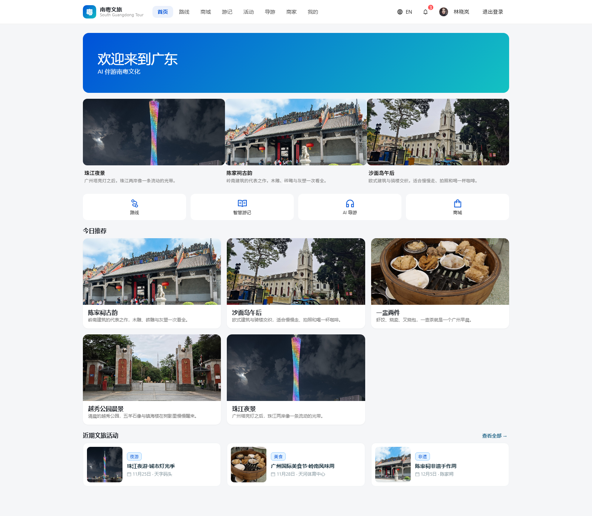
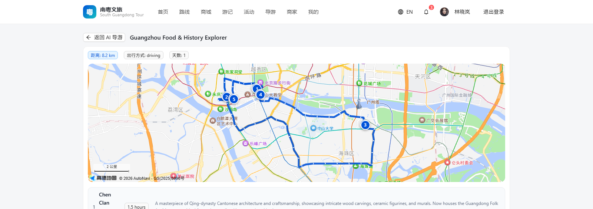
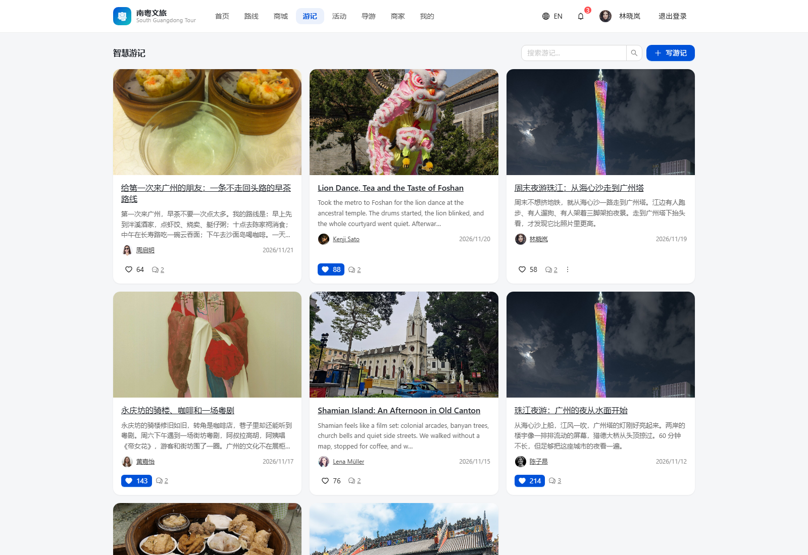
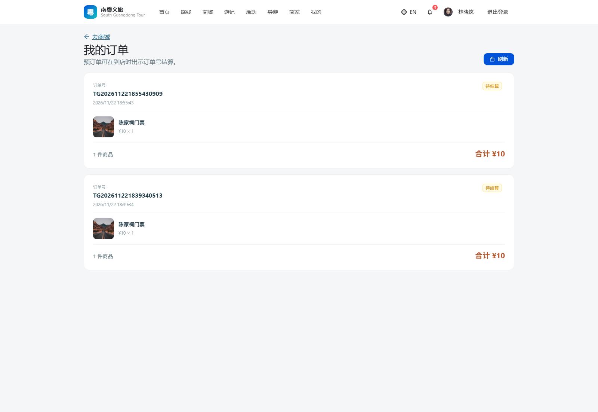
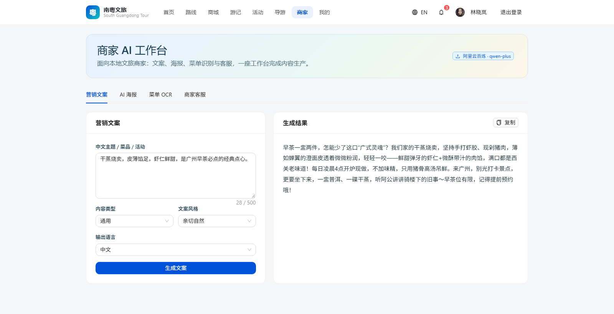
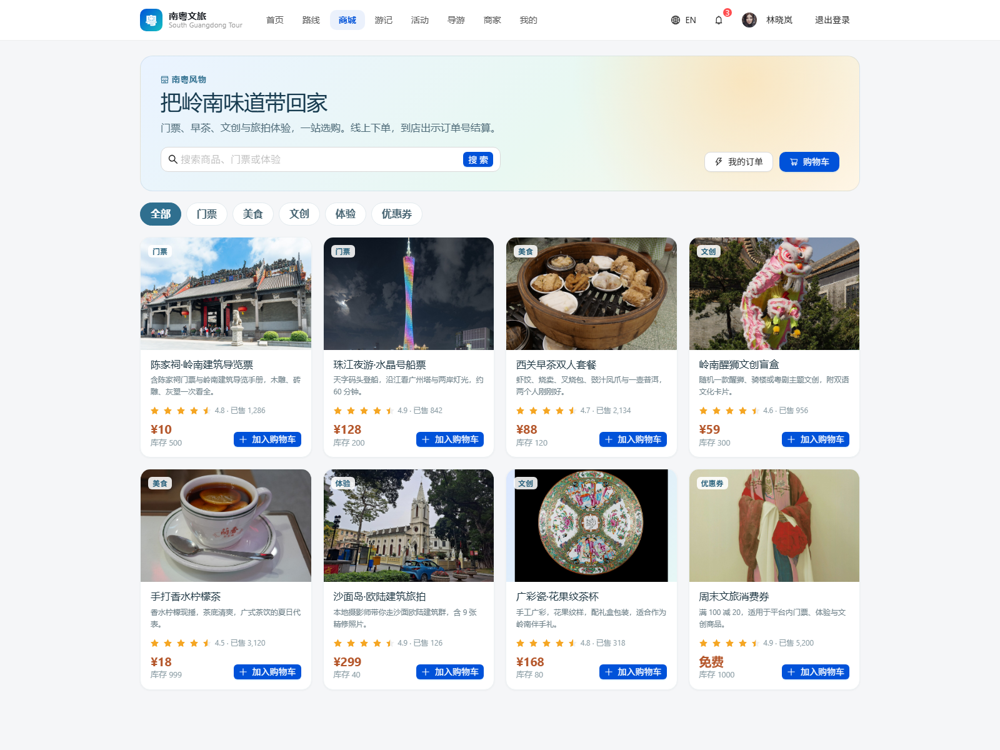
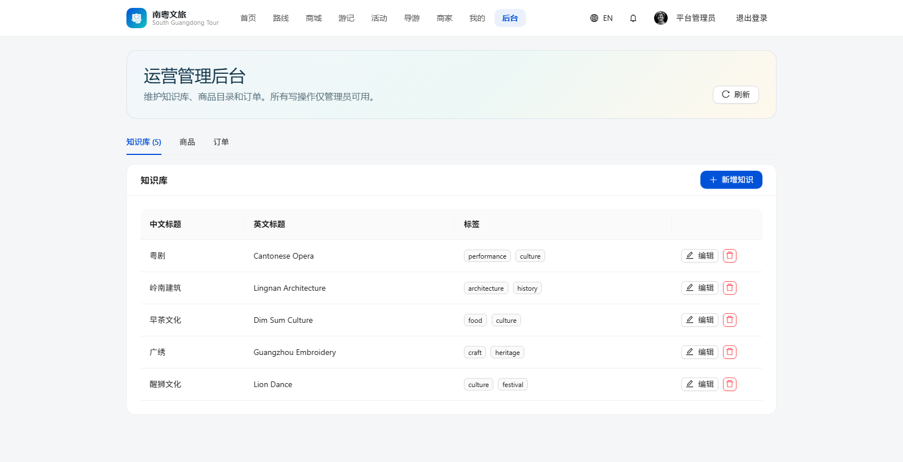
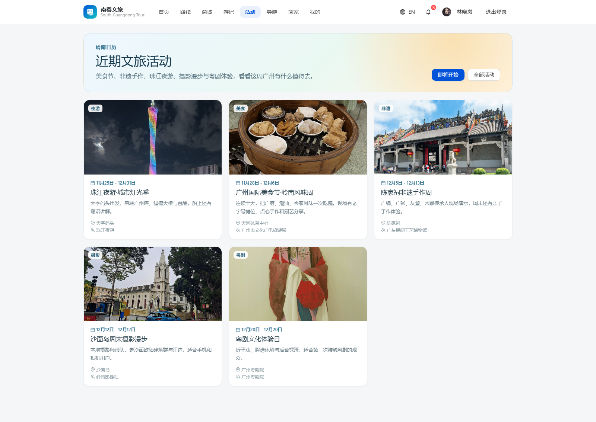

# 南粤文旅智慧旅游网站建设进度报告

**——“南粤文化入境游 AI 智能伴游系统”网站部分阶段成果**

版本：V1.0        编制日期：2026 年 11 月 22 日        编制：项目开发组

## 摘要

本报告对“南粤文旅”智慧旅游网站截至 2026 年 11 月 22 日的建设进度进行阶段性总结。网站已完成 React 前端、Go 后端、MySQL 数据库、AI 模型与高德地图的联调，游客端、商家 AI 工作台、商城订单和运营后台形成完整业务闭环，具备演示、截图和申报材料撰写条件。

总体判断是：核心功能闭环已经完成，产品化收尾仍在进行。真实支付、物流、退款、商家入驻、多商户结算、知识库规模化、小程序真机验收、自动化测试与线上运维尚未完成。建议按“演示交付—生产化—规模化”三个阶段推进。

## 一、项目概况

### 1.1 项目定位

南粤文旅智慧旅游网站是“南粤文化入境游 AI 智能伴游系统”的 Web 端载体，面向入境游客与本地文旅商家两类用户。网站与微信小程序共用同一套 Go 后端、MySQL 数据与 AI 能力，承担游客主流程、商家内容生产、商城交易和运营管理四类场景，是小程序之外面向桌面端与移动浏览器的完整服务入口。

### 1.2 建设目标

本期建设以“AI 伴游 + 本地文化知识库 + 商家赋能 + 交易闭环”为主线，目标是把前期页面原型升级为可登录、可生成、可发布、可下单、可管理的全栈系统，并形成可演示、可截图、可部署的阶段成果。网站不是小程序的简单翻版，而是把同一套 AI 与数据能力延伸到更完整的游客服务、商家工作台和运营后台。

### 1.3 当前阶段

截至 2026 年 11 月 22 日，网站已完成 React 前端、Go 后端、MySQL 数据库、AI 模型与高德地图的联调。游客端、商家端、商城和后台均可通过演示账号走通，前端与后端已具备一体化启动与部署能力。项目当前处于“演示交付与材料撰写”阶段；真实支付、物流、微信真机验收和生产级运维尚未完成。

## 二、总体建设进度

### 2.1 阶段判断

网站已不再停留在静态页面或单点接口阶段。前端 14 个路由页面、后端 70 余个 HTTP 接口、22 张业务表和 user / merchant / admin 三类角色已经形成完整链路：游客可以登录、浏览内容、生成 AI 路线、发布游记、与 AI 导游对话；商家可以生成营销文案、海报、识别菜单；用户可以加购、下单、查看订单；管理员可以维护知识库、商品和订单状态。

从工程实现看，前端采用 React 18 + Vite + Ant Design，后端采用 Go + Gin + sqlx + MySQL 8，认证采用 JWT + bcrypt，AI 接入阿里云百炼 qwen-plus、qwen3-vl-plus 与万相，地图接入高德 JS API 与 Web 服务。Java 后端已冻结为学习对照版本，网站与小程序统一以 Go 为唯一运行后端，避免双后端功能漂移。

### 2.2 模块完成情况

| 模块 | 状态 | 当前说明 |
| --- | --- | --- |
| 游客端（首页 / 路线 / 游记 / 导游 / 个人中心） | 已完成 | 可登录、可生成、可发布、可对话，支持中英文切换 |
| 商家 AI 工作台 | 已完成 | 文案、菜单 OCR 已实测；海报异步接口已接通；商家客服可用 |
| 文旅活动日历 | 已完成 | 5 场活动；首页推荐 3 场，活动页支持筛选与详情 |
| 商城与订单 | MVP 完成 | 商品、购物车、下单、库存扣减、订单查询；支持评分、已售与精选评价 |
| 运营管理后台 | MVP 完成 | 知识库、商品、订单管理；仅 admin 角色可访问 |
| 账号与权限 | 已完成 | user / merchant / admin 三角色；JWT + bcrypt；后台接口 403 校验 |
| 数据与知识库 | 基础完成 | 8 篇游记、19 条评论、5 条知识、5 个地点、8 个商品、5 场活动；知识库规模仍需扩充 |
| 微信小程序 | 功能完成 | 模拟器可联调；真机、HTTPS 域名、微信配置待验收 |
| 部署与运维 | 基础完成 | 本地 / Docker / Azure 文档齐全；HTTPS、监控、备份待完善 |
| Java 后端 | 已冻结 | 保留为 Java↔Go 学习对照，不再接入网站 |
| 测试与 CI | 部分完成 | Go 测试与前端构建通过；E2E、CI、压力测试待补 |

### 2.3 与参考材料的对应关系

参考材料中的“核心数据资源”“商家 AI 助手”“智能伴游”三部分，在本期网站中均有对应落地，形成了从数据到功能、从功能到界面的完整映射：

- 核心数据资源：knowledge（文化知识）、places（地点）、scenic_images（首页视觉）三张核心表，为 AI 导游、路线规划、文化卡片提供检索与生成依据。
- 商家 AI 助手：对应网站 /#/merchant，包含多语种营销文案、AI 海报、菜单 OCR / 翻译 / 文化卡片、商家客服四个页签。
- 智能伴游：对应网站 /#/route、/#/blog、/#/guide，覆盖个性化路线、实景地图、AI 游记、AI 导游与 Agent 行程确认。
- 文旅活动：对应网站 /#/activities 与首页“近期文旅活动”，把美食节、非遗手作、珠江夜游、摄影漫步和粤剧体验组织成可浏览的活动日历。
- 文创商品销售：对应网站 /#/shop、/#/orders 与运营后台，完成商品展示、购物车、下单与订单状态管理，是参考材料中“文创商品销售”的 Web 版 MVP。
---

## 三、已完成功能

### 3.1 游客端智能伴游

#### 3.1.1 首页与目的地推荐

首页采用“欢迎横幅 + 目的地轮播 + 快捷入口 + 今日推荐”的结构，数据来自 scenic_images 表，支持中英文即时切换。快捷入口覆盖路线、游记、AI 导游和商城，今日推荐按日期稳定轮换，避免每次刷新内容跳动。

*图 1  网站首页*

#### 3.1.2 AI 个性化路线与高德地图

路线页提供天数、兴趣、节奏、出行方式四类输入，后端调用 qwen-plus 生成结构化行程，再由高德地图 Web 服务规划真实道路 polyline。地图页展示途经点、路线、总距离、天数与建议停留时间，路线结果写入 routes 表，可在个人中心回看。该功能把“AI 生成”与“地图可执行”连在一起，避免只给出一段无法落地的文字行程。

*图 2  “智能伴游”功能示意——AI 路线与高德地图*

#### 3.1.3 智慧游记

游记模块支持列表、详情、发布、编辑、删除、图片上传、AI 起草、点赞、评论、搜索与分页。当前内容库有 8 篇游记、19 条评论，作者来自广州、加拿大、日本、德国等不同地区，内容为中英文混合的真实旅行记录。用户上传图片后，图片写入后端 uploads 目录并通过 /uploads 静态路由访问；前端统一通过 assetUrl 处理相对路径，开发环境与生产环境都能稳定显示。此前开发环境中部分上传图片无法显示的问题已经定位并修复，当前页面 0 破图。

*图 3  智慧游记列表（上传图片链路修复后）*

#### 3.1.4 AI 导游与 Agent 行程规划

AI 导游采用 Agent 架构：用户自然语言输入后，后端通过 OpenAI-compatible 接口调用 qwen-plus，结合 search_places、get_place、list_favorites、search_knowledge、get_weather、route_leg、plan_itinerary、submit_plan、list_my_routes 等工具完成检索、路线计算和方案生成；前端通过 SSE 接收 delta、thinking、tool_call、tool_result、plan、done 等事件。方案卡片经用户确认后再幂等写入 routes，模型不能伪造途经点、时间或距离。

与传统聊天机器人相比，该模块的重点不是“会聊天”，而是“能调用工具并把结果落库”。同时实现了取消、超时、并发上限、队列等待、限流、断线重连和启动恢复，保证演示时不会因为一次长请求把系统拖垮。

#### 3.1.5 个人中心与通知

个人中心提供注册 / 登录、JWT 会话、头像上传、昵称编辑、收藏、历史路线、我的文章、粉丝 / 关注统计和中英文切换。通知中心支持未读筛选、单条已读和全部已读，点赞、评论、关注都会生成通知。个人主页可查看其他用户资料、文章和关注关系，形成游客之间的轻量社交闭环。

*图 4  我的订单与预订单结果*

### 3.2 商家 AI 助手

商家 AI 助手对应参考材料 2.1.2 的“赋能供给侧”部分，落在网站 /#/merchant。页面以四个页签组织商家最常用的内容生产与咨询场景，商家只需输入中文主题或上传菜单图片，即可获得可直接使用的多语种内容。

#### 3.2.1 多语种营销文案

商家输入菜品、活动或景点主题，选择内容类型、文案风格与输出语言，后端调用 qwen-plus 生成营销文案。实测输入“干蒸烧卖，皮薄馅足，虾仁鲜甜，是广州早茶必点的经典点心”，可生成完整的中文社交媒体文案，包含场景、口感、文化背景和行动号召。

*图 5  “商家 AI 助手”功能示意——营销文案生成*

#### 3.2.2 AI 海报

海报模块接入通义万相异步任务：商家填写提示词、选择风格后提交任务，前端轮询任务状态，成功后展示图片并支持下载。海报生成通常需要 10–30 秒，页面会提示保持打开。验收时已用真实提示词生成一张广式早茶海报，结果保存于 docs/screenshots/website/10-ai-poster.png。

#### 3.2.3 菜单拍照翻译与文化卡片

菜单模块支持上传 JPG / PNG，调用 qwen3-vl-plus 识别菜名与价格；识别结果按行拆分为菜品关键词，点击关键词可生成文化卡片，或让 AI 服务员用简单语言解释菜品。翻译功能支持 English、日本語、한국어、Español、Français 等目标语言，输出“原名 → 译名 + 文化/饮食提示”的结构化结果。实测菜单图片可以正确识别干蒸烧卖、叉烧包、豉汁凤爪、艇仔粥等菜品及价格。

#### 3.2.4 商家客服

商家客服复用 AI 导游的多轮对话能力，提供营业时间、招牌菜、英文介绍、周末活动等快捷问题，适合门店前台或运营人员快速生成对客回复。该模块与游客端导游共享会话与知识库能力，但入口和话术面向商家。

### 3.3 商城与订单

商城是参考材料“文创商品销售”的 Web 版 MVP，当前包含 8 个商品，覆盖门票、美食、文创、体验、优惠券五类，商品卡片展示评分、已售数量与库存，详情页展示精选用户评价。用户可以按分类浏览、搜索、查看详情、加入购物车、调整数量、删除商品并提交订单；服务端按数据库价格重新计价，使用事务扣减库存，并通过 Idempotency-Key 保证重复提交不会重复下单。订单页展示订单号、状态、商品明细、金额和创建时间，管理员可在后台修改订单状态。

当前商城定位为“预订单交易”：生成 pending 订单、扣减库存、支持订单查询与状态管理，到店出示订单号结算；微信支付 / 支付宝、物流、退款和优惠券核销仍未接入。这样既能把交易链路演示完整，又不会在未完成支付合规与商户资质前给出虚假的“可收款”能力。

*图 6  南粤风物商城*

### 3.4 运营管理后台

运营后台对应商家与平台运营人员的日常维护工作，落在网站 /#/admin，仅 admin 角色可见“后台”导航。后台包含三个页签：知识库 CRUD、商品 CRUD / 上下架、订单状态管理。普通用户访问 /api/admin/* 返回 403，管理员可以新增知识条目、修改商品价格与库存、把订单从 pending 改为 paid / completed / canceled。

*图 7  运营管理后台——知识库*

### 3.5 文旅活动日历

活动页把广州近期可参与的文旅活动组织成日历：广州国际美食节、陈家祠非遗手作周、珠江夜游灯光季、沙面岛摄影漫步和粤剧文化体验日。每场活动包含时间、地点、主办方、标签、封面图和详情说明，首页展示最近三场并链接到完整活动页，解决“来广州除了景点还能做什么”的信息缺口。

*图 8  文旅活动日历*

## 四、技术架构与数据底座

### 4.1 总体架构

网站采用前后端分离架构：web/ 为 React 18 + Vite 5 + Ant Design 5 + i18next 前端；server-go/ 为 Go 1.25 + Gin + sqlx + MySQL 8 后端；nginx/ 与 docker-compose.yml 负责静态托管、/api 与 /uploads 反向代理；deploy/ 提供 Azure 单机部署、systemd、nginx 与回滚文档。前端通过 HashRouter 适配静态托管，后端统一返回 {success, data, message} 信封，认证使用 JWT + bcrypt。

Java 后端 server-java/ 已冻结为学习对照版本，只保留早期 catalog / auth / blog / route / guide 接口，不再接入网站或小程序。该决策避免了评论、关注、通知、上传、AI 文案 / 海报 / OCR、Agent 等新功能在 Java 与 Go 之间重复实现和维护。

### 4.2 AI 能力矩阵

| 能力 | 模型 / 服务 | 应用场景 |
| --- | --- | --- |
| 营销文案、路线、游记草稿、AI 导游 | qwen-plus | 商家文案、路线生成、AI 起草、导游对话 |
| 菜单 OCR、翻译、文化卡片 | qwen3-vl-plus + qwen-plus | 菜单识别、菜品翻译、文化解释 |
| AI 海报 | 通义万相 Wanx | 商家活动海报、菜品海报 |
| 地图与天气 | 高德 JS API / Web 服务 | 路线 polyline、距离、天气提示 |
| Agent 行程规划 | DashScope OpenAI-compatible + tools + SSE | 工具调用、确定性行程求解、方案确认落库 |

上述能力均来自后端真实调用，不是前端 mock。后端读取 DASHSCOPE_API_KEY 后直接请求阿里云百炼：营销文案走 qwen-plus，菜单识别与翻译走 qwen3-vl-plus，海报走通义万相异步任务，Agent 走 DashScope 的 OpenAI-compatible 接口。本次验收实际调用了 qwen-plus 生成中文营销文案、qwen3-vl-plus 识别菜单菜名与价格，并通过通义万相生成一张广式早茶海报，均返回真实结果。

### 4.3 数据资源与知识库

截至 2026 年 11 月 22 日，数据库包含 13 个用户、8 篇游记、19 条评论、8 个商品、18 条精选评价、3 个订单、5 场活动、5 条知识、5 个地点、3 条路线。知识库覆盖醒狮、广绣、早茶、岭南建筑、粤剧等主题，为 AI 导游、文化卡片和路线推荐提供检索依据。

与参考材料提出的“500–1000 条双语知识库”目标相比，当前知识库仍处于起步规模。下一阶段需要把南粤古驿道、非遗、老字号、民俗节庆、历史典故等文化要素结构化、标签化、多语种化，形成可检索、可调用、可迭代的专用知识库；同时继续补充商家授权图片和自有拍摄素材。

### 4.4 安全、稳定与工程化

网站在工程化方面补齐了一批容易被页面阶段忽略的问题：后台接口按数据库角色实时校验，避免旧 JWT 继续拥有管理员权限；商城下单使用事务扣库存与幂等键；上传限制图片类型与 5MB 大小；前端统一 assetUrl 与占位图，图片失效不再出现破图；MySQL 时区统一为东八区，博客与订单时间显示正确；Agent 使用 MySQL advisory lock 保证单实例启用，第二实例自动降级；新增 /healthz 健康检查与 release 模式 JWT secret 校验。

前端已按路由懒加载拆分，首屏包体从约 1.45MB 降至约 776KB，商城、后台、商家工作台等页面只在访问时加载。仍存在 Ant Design 单块体积偏大的构建 warning，但不影响运行，后续可继续做组件级拆分。

## 五、当前进度评估

### 5.1 完成情况

按本期网站范围，核心业务闭环已经完成：游客端能完成“浏览—生成—发布—对话—收藏”，商家端能完成“文案—海报—菜单识别—客服”，交易端能完成“商品—购物车—下单—订单”，后台能完成“知识库—商品—订单”的维护。网站已具备演示、截图、申报材料和软著文档所需的功能基础。

但按生产级平台标准，网站仍处于 MVP 后期：真实支付、物流、退款、商家入驻、多商户结算、内容规模、真机验收、自动化测试与线上运维尚未完成。当前更适合“演示交付”，不宜直接对外经营。

### 5.2 验收结果

| 验收项 | 结果 |
| --- | --- |
| Go 后端测试 go test ./... | 通过 |
| 前端生产构建 npm run build | 通过；首屏约 776KB，仍有 AntD 单块 warning |
| 页面图片检查 | 首页、游记、商城、后台等页面 0 破图 |
| 登录与角色 | demo / merchant / admin 均可登录；demo 访问后台返回 403 |
| 商城下单 | 成功；库存扣减；相同 Idempotency-Key 重试返回同一订单 |
| Agent 健康检查 | /healthz 返回 agent:true；第二实例自动 agent:false |
| AI 能力 | 营销文案、菜单 OCR、AI 海报均已实测通过 |
| 活动日历 | 5 场活动；首页展示 3 场，/#/activities 正常 |
| 小程序 | 开发者工具可联调；真机待 HTTPS 域名、AppID/Secret 与合法域名配置 |

### 5.3 演示账号与入口

| 角色 | 账号 / 密码 | 主要入口 |
| --- | --- | --- |
| 游客 | demo / demo123 | /#/、/#/route、/#/blog、/#/guide、/#/profile |
| 商家 | merchant / merchant123 | /#/merchant、/#/shop、/#/orders |
| 管理员 | admin / admin123 | /#/admin、/#/shop、/#/orders |

## 六、风险与不足

当前风险主要集中在产品化收尾，而不是核心功能缺失。建议在材料中如实说明边界，避免把 MVP 描述为已上线交易平台。

- 交易闭环未完成：未接真实支付、物流、退款、优惠券核销与多商户结算，商城订单状态目前由后台手工推进。
- 知识库规模不足：当前 5 条知识，距离 500–1000 条目标差距明显，需要内容团队持续整理与双语校对。
- 小程序真机未验收：真机需要已备案 HTTPS 域名、微信合法域名、WX_APPID / WX_SECRET，本地 127.0.0.1 只能用于模拟器。
- 多实例能力有限：Agent 的 SSE、海报任务状态在进程内，当前用单实例锁保护；水平扩容需要 Redis 或独立任务队列。
- 测试与 CI 不完整：Go 侧已有 planner / agent / ai 等测试，但缺少端到端、权限、商城并发与前端组件测试，也尚未接入 CI。
- 内容素材授权：商品、景点与活动图片当前使用 Wikimedia Commons / Unsplash 演示素材，正式商用前需要替换为商家授权图片或自有拍摄素材。
- 代码尚未提交：当前仓库仍有大量未提交改动，建议在截图与文档完成后按模块整理 commit，避免成果丢失。
- AI 依赖外部额度：文案、OCR、海报依赖 DashScope 额度与网络，海报生成 10–30 秒，演示前应预留时间并准备失败提示。
## 七、下一步计划

| 阶段 | 重点工作 | 预期产出 |
| --- | --- | --- |
| 近期（1 周） | 补齐知识库与商品素材；完成全套截图；整理未提交代码；更新 README / API 文档 | 可演示、可截图、可提交的阶段版本 |
| 中期（2–4 周） | 接入微信支付 / 订单状态机；后台审计日志；HTTPS 域名与生产部署；E2E / CI | 可对外试运行的网站版本 |
| 中期（2–4 周） | 小程序真机验收、微信登录、上传与商家页面联调 | 小程序 + 网站双端演示 |
| 后续 | Redis / 任务队列、监控告警、备份恢复、商家入驻与多商户结算 | 可规模化运营的文旅交易平台 |

## 八、结论

南粤文旅智慧旅游网站已经完成从页面原型到全栈可运行系统的跨越：游客端、商家 AI 工作台、商城、订单与运营后台形成闭环，AI、地图、数据库、权限和上传链路均已实接，具备演示、截图和申报材料撰写条件。

下一阶段的重点不是继续堆页面，而是补内容、补交易合规、补真机与生产运维、补测试与代码管理。建议按“演示交付—生产化—规模化”三步推进：先把当前成果稳定交付，再完成支付与内容建设，最后通过 Redis、任务队列和监控体系支撑更大流量与多商户运营。
